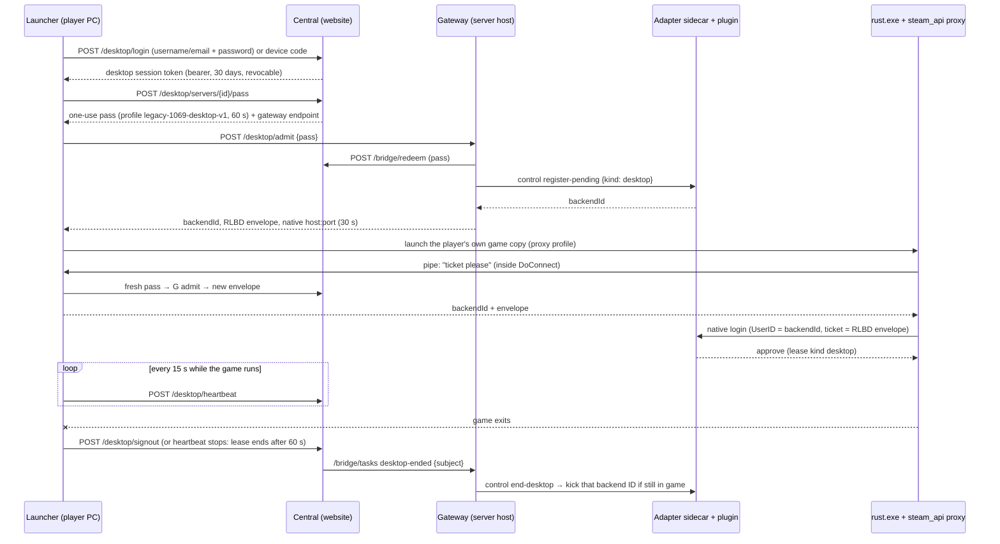

# Desktop launcher: one website account for desktop play

> **Un-paused (owner, 2026-10-24, option 1).** The `steam_api` proxy (`launcher/proxy/`) and the launch profile (`launcher/host/ProfileBuilder.cs`) are back in scope, **for servers that run our adapter only**: the loader arms the proxy only after that server's own gateway has admitted the player (a server listed on our website, running our gateway, sidecar and adapter), and the envelope it hands the game means nothing to a server without our adapter. Nothing changes for servers that do not run it. This answers the open question of 23 October (how desktop players reach a LauncherOnly server): through the loader. **Next gate: the first VM test with the real game** (next step 1 below). Also decided on 24 October: players need a website account (no guest or local accounts), and new players sign up inside the loader (section 1). Tracker: `HOST-AND-LOADER-BUILD.md`.
>
> *History: paused on 2026-10-23 (no further work, VM test or release; "nothing on the player's PC stands in for Steam sign-in"), lifted by the 24 October decision above.*

22 October 2026. Feasibility answer from static analysis, the design, and the first slice that is built and mock-tested. Nothing here has been run against the original client or server. Original binaries were only read as bytes (PE headers, export/import tables, a few instruction bytes). They were never executed or loaded.

## What the owner asked for

> "when they open rust game or the rust loader, it pops up first asking them to login to their account (login details from our site) then they click connect to connect to our site, then they click launch game, and this stays in the background keeping the connection, while the game loads, this is on desktop."

## Answer: feasible, with one project-owned DLL on the player's PC and the existing server adapter

The desktop client never invents its identity. Both the UInt64 player ID and the auth-ticket bytes it sends come from `steam_api.dll`, through `librust.dll`, at the moment of connecting. A project-owned `steam_api` proxy can answer those two calls with values from the launcher:

- a website-mapped ID chosen by the server's own identity map;
- a one-use `RLBD` envelope, minted by that server's gateway.

Everything else goes to the player's existing `steam_api.dll` unchanged. The server-side branch already exists for browsers (the `RLBA` envelope handled at `uLink_OnPlayerApproval`). Desktop reuses it with a distinct magic.

## Evidence (static only)

### Client: where the ID and ticket come from

`analysis/decompiled/client/Assembly-CSharp/ClientConnect.cs`, `DoConnect(strURL, iPort)`:

| Line | Call | Use |
| --- | --- | --- |
| 33 | `ProtectLoader.OnConnect(strURL, iPort)` | RustProtect loader (see risks) |
| 34 | `Steam_GetSteamID()` (`[DllImport("librust")]`) | only checked for 0 ("no steam detected") |
| 43 | `SteamClient_GetAuth(buf, 1024)` | ticket bytes, at most **1024** |
| 48–52 | `WriteInt32(1069)`, `WriteByte(2)`, `WriteUInt64(Steam_GetSteamID())`, `WriteString(displayname)`, `WriteBytes(ticket)` | the native login data |

The client does not use its own SteamID anywhere else (searched the whole decompiled client: only these three references).

`librust.dll` (client, sha256 `7cc1d293…f349b`): its import table takes `SteamUser` and `SteamFriends` (and 18 more) from `steam_api.dll`. Reading the exported functions' bytes:

- `Steam_GetSteamID` @ `0x10002890`: `mov esi,[0x100a0234]` (IAT slot = `steam_api!SteamUser`), `call esi`, `mov edx,[eax]`, `mov edx,[edx+0x08]`, `call edx`. That is **ISteamUser vtable slot 2 = `GetSteamID`**.
- `SteamClient_GetAuth` @ `0x100024c0`: if a previous handle is stored at `[0x100c27e0]`, call `[vtbl+0x40]` (**slot 16 = `CancelAuthTicket`**). Then call `[vtbl+0x34]` (**slot 13 = `GetAuthSessionTicket(pTicket, cbMax, &pcbTicket)`**), store the new handle, and return `pcbTicket`.
- `Steam_GetDisplayname` @ `0x10002790`: `SteamUser()` and `SteamFriends()`; the name comes from SteamFriends.

The interface versions come from `ValveAPI.dll` (the Valve `steam_api` that the community LumaEmu `steam_api.dll` wraps): `SteamUser016`, `SteamFriends013`, `SteamClient012`, `SteamUtils005`, `STEAMAPPS_INTERFACE_VERSION005`. Slots 2/13/16 match the ISteamUser016 layout.

On community builds `steam_api.dll` (sha256 `45b2de34…6d688`) is LumaEmu: it exports `IsLumaEmu` and reads `LumaEmu.ini`. That is why desktop IDs there are configurable and spoofable today.

### Server: what checks them

`analysis/decompiled/server/Assembly-CSharp/`:

- `ConnectionAcceptor.uLink_OnPlayerApproval` runs these checks in order: capacity, `ReadConnectionData`, protocol `1069`, `BanList.Contains(UserID)`, `IsConnected(UserID)`. Then `m_Connections.Add` and `AuthorisationRoutine`.
- `ClientConnection.ReadConnectionData` reads `Protocol`, `ConnectionMode` (must be 2), `UserID` (UInt64), `UserName`, `SteamTicket = ReadBytes()`.
- `AuthorisationRoutine` → `DoSteamAuthorisation` → `Server.StartUserAuth(UserID, SteamTicket)` (native `librust` `SteamServer_BeginAuthSession`). It then waits up to 10 s for `AuthStatus` and, if `Server.SteamGroup != 0`, runs `DoSteamGroupTest`. It approves with the 8 world-info fields.
- The existing adapter (`adapter/RustLegacyBrowser.cs`) hooks Oxide `IOnUserApprove`, patched into `uLink_OnPlayerApproval` at IL index 49, before `AuthorisationRoutine`. It recognises the `RLBA` magic and asks the loopback sidecar (`bridge/sidecar.mjs` → `bridge/adapter.mjs onNativeApproval`). Normal logins fall through to the native path untouched.

So the server never needs a Valve ticket for our players. It needs the same proof the browser path gives: a pending admission registered by the gateway after central verified the account, then possession of that one-use secret, with the claimed ID equal to the mapped backend ID.

### Fit

| Constraint | Value | Envelope |
| --- | --- | --- |
| Ticket buffer | 1024 bytes (`SteamClient_GetAuth(buf,1024)`) | `RLBD` envelope is 53 bytes |
| Server read | `BitStream.ReadBytes()` (length-prefixed) | no format check before the hook |
| Claimed ID | any non-zero UInt64 | server-mapped backend ID |
| Display name | `SteamFriends` persona name | website display name, sanitised |

## Design



### 1. Sign in

The launcher opens with a sign-in card. It offers two methods:

- **Username or email + password.** `POST /desktop/login` uses the same password check, lockout (10 failures → 15 min) and suspension rules as `POST /auth/password`. It returns a bearer token, not a cookie. Native apps have no Origin, so CSRF does not apply; the token is the credential. The launcher stores it with Windows DPAPI (current user) only when "Keep me signed in" is ticked.
- **Steam accounts (no password).** A device code. `POST /desktop/device` returns a short user code and the website URL. The player opens it in a browser where they are already signed in and approves it (`POST /desktop/device/approve`, session + CSRF). The launcher then polls `POST /desktop/device/token`. Codes last 10 minutes and work once. The website page is `/desktop/approve`: the player types the code (it is never taken from a link, so a link carrying someone else's code cannot sign their launcher in as you). The account page lists signed-in launchers with a Sign out button each.

- **Create account (new players, 2026-10-24).** Players need a website account; the loader makes one. The Account step has a **Sign in / Create account** switch over one form. Create account asks for what the website's register page asks: email, username, password, and the same notice ("By creating an account you agree to the Terms of use and Privacy policy. You must be 13 or older.", links opened in the player's browser; the website has no tick box for it either). `POST /desktop/register` runs the website's own sign-up (`central/accounts.mjs` `register()`, shared with `POST /auth/register`): the same rules and codes, the same `login` rate-limit bucket, the throwaway-domain list, one account per mailbox and the network-ban checks. It skips only the website form's Origin check (a native app has none; it gets a bearer token, not a cookie), takes `hwid` like login, refuses a sign-up from a PC that a network-banned account used (`identity-banned`), and answers exactly like `/desktop/login`. Email verification is sent as on the website; nothing waits for it, and `/auth/complete-signup` is only for Steam sign-ups, so the account is complete at once: the same password signs in on the website.
- **Two ticks, on both forms.** "Remember my email or username": the name as typed (the username after a sign-up) is kept in the host's `settings.json` (bridge `saveLogin`) and prefilled next time; unticked forgets it. "Keep me signed in on this PC": the DPAPI token store above. The password is never stored anywhere.

Desktop sessions are their own table (`desktop_sessions`), listed apart from website cookies. "Sign out everywhere" (`POST /account/sessions/revoke`) also ends them. Sign-out deletes the session.

### 2. Connect

The player picks a server (the same directory as the website: `GET /desktop/servers`) and clicks **Connect**.

1. The launcher asks central for a **desktop pass**: `POST /desktop/servers/{id}/pass`. Central runs the same checks as `join-ticket`: listed, online, not banned, server policy (account age / Steam required). It issues an Ed25519 admission with `profile: legacy-1069-desktop-v1`, valid 60 s and usable once.
2. The launcher sends the pass to that server's gateway: `POST /desktop/admit` on the registered endpoint's origin (`wss://host/play` → `https://host/desktop/admit`). The pass travels in the body, never the URL.
3. The gateway redeems the pass with central (`/bridge/redeem`, per-server credential, atomic one-use). Central refuses browser passes at this route and desktop passes on the WebSocket. The gateway then registers a pending desktop admission with the adapter (`register-pending`, `kind: 'desktop'`).
4. The adapter (server-authoritative identity map) resolves the account to its backend ID. A linked desktop character resolves to that character's ID. A new player gets an ID allocated in the operator's namespace. It refuses when no identity is possible (no arbitrary-ID fallback), the ID is banned, or a live session holds the ID.
5. The gateway answers `{backendId, envelope, native:{host,port}, expiresInSeconds}`.

The launcher shows **Connected** with the server name and keeps the backend ID for this server. The first envelope is discarded; it expires on its own after 30 s. The game will ask for a fresh one when it actually connects, because the player may sit in the main menu for minutes.

### 3. Launch game

The player chooses their own game folder once (the launcher checks it holds `rust.exe` and `rust_Data`). The launcher never downloads, copies over the network or ships any original file.

**Proxy profile (preferred: the install stays unchanged).** The launcher builds a launch folder under `%LOCALAPPDATA%\RustLegacyLauncher\profile\` containing:

- `rust.exe`, `steamclient.dll`, `LumaEmu.ini`, `steam_appid.txt`, `ValveAPI.dll` as **hard links** to the player's own files (same volume; otherwise a local copy on the same PC);
- `rust_Data` and `cfg` as **directory junctions**;
- the player's `steam_api.dll` hard-linked as `steam_api_upstream.dll`;
- the project's proxy as `steam_api.dll`.

Unity resolves `<exe name>_Data` next to the exe. The Windows loader takes `steam_api.dll` from the exe's folder first. So `librust` binds to the proxy, which loads `steam_api_upstream.dll` and forwards every export. Uninstalling the launcher just deletes that folder.

**In-place swap (fallback for FAT/exFAT drives or another volume).** Rename the original to `steam_api_upstream.dll` and put the proxy beside it, restoring on exit and on the next launcher start. This changes the player's install while playing, so it is opt-in and shown as such.

**The proxy (`steam_api.dll`, project-owned C++, x86).** It forwards every export and every interface method to `steam_api_upstream.dll`. The only exception is `SteamUser()`: that returns a wrapper whose vtable forwards all ISteamUser016 slots except:

- slot 2 `GetSteamID` → the launcher's backend ID for the armed server;
- slot 13 `GetAuthSessionTicket` → asks the launcher over a named pipe (`\\.\pipe\rlb-launcher-<user SID>`, ACL current user only) for a fresh envelope. The launcher gets a new pass from central, admits at the gateway, and returns `{backendId, envelope}` within the 10 s the server waits. The proxy copies the 53 bytes into the caller's buffer and returns a dummy handle;
- slot 16 `CancelAuthTicket` → a no-op for our dummy handle.

`SteamFriends()` is wrapped only so `GetPersonaName`/`GetFriendPersonaName(self)` return the website display name. When the launcher is not running, or no server is armed, the proxy forwards everything: the game behaves exactly as before, with the player's normal identity.

**Picking the server in game.** `cfg/favourites.cfg` is executed at startup (`FavouriteList.Load` → `ConsoleSystem.RunFile`). The launcher adds `serverfavourite.add "host:port"` for the armed server, so it appears in Favourites. `net.connect host:port` (and `net.reconnect`, PlayerPrefs `net.lasturl`) also work. Auto-connect on start (a `net.connect` line run at that point) is a candidate to test, not promised.

### 4. Background: heartbeat, lease, renewal, sign-out

After launch the window minimises to the tray ("In game on Pilot · connected"):

- **Heartbeat.** `POST /desktop/heartbeat {serverId, state}` every 15 s keeps the desktop **lease** (60 s) for that server. Central refuses passes for a server that another of the account's desktop sessions holds a live lease for. This is the central half of "one live session per account per server". The adapter's lease is the server half.
- **Pass renewal.** Passes are never cached: every native connect asks for a new one (one-use, 60 s). Reconnecting after a disconnect or a server restart therefore works without the player doing anything.
- **Game exit.** The launcher watches the `rust.exe` process. When it exits, the launcher calls `POST /desktop/heartbeat {state:'idle'}` (lease released) and returns to Connected. Sign-out (`POST /desktop/signout`) deletes the session and releases every lease.
- **Launcher killed or PC offline.** Heartbeats stop and the lease expires after 60 s. Central then queues `desktop-ended {subject}` for that server in `/bridge/tasks`. The gateway sends `end-desktop`; the adapter queues a kick for that backend ID, only if it holds a **desktop** lease (browser sessions and native Steam players are never touched). Native disconnect clears the adapter lease as today.

Policy choice for the owner: kick-on-lease-loss is on by default (gateway config `desktop: {publicHost, publicPort, leaseKick}`; `leaseKick` defaults to true). It enforces "the launcher keeps the connection". Turning it off makes the launcher only matter at join time.

### 5. Rules from BROWSER-SERVER-DECISION.md, applied

| Rule | Desktop design |
| --- | --- |
| Server authoritative for its identity map | The backend ID comes only from the adapter (`register-pending` reply). Central never sees it: central keeps only the salted `backend_ref` for links, as today. |
| No auto-link by name/email/IP | Desktop sign-in maps the website account, never the LumaEmu ID or nickname on the PC. An existing desktop character is linked once with `/browserlink` (below). |
| No arbitrary-ID fallback | With no namespace and no link, the adapter returns `no-identity` and the launcher says so. The proxy never makes up an ID. |
| One live session | Adapter lease (native) + central desktop lease. A second desktop or browser join is refused, and an unverified join never kicks a live one. |
| Proof bound to the connection | One-use secret (sha256 digest in the adapter, 30 s), one attempt, `claimedUserId` must equal the backend ID, the envelope kind must match the pending kind. Optional operator policy: also require the native source IP to equal the IP the gateway saw at admit (a check on top of the proof, never an identity). |
| Never present it as a Steam ticket | Distinct `RLBD` magic; the plugin only hands `RLBA`/`RLBD` envelopes to the adapter; everything else stays on the native path. |
| Steam group whitelist | `Server.SteamGroup != 0` refuses envelope logins (`group-whitelist`), as for browsers. |

### 6. How this relates to `/browserlink`

They complement each other:

- **`/browserlink` stays the way to claim an existing desktop character.** A player who has played the server with their old LumaEmu/Steam identity joins once the old way (launcher not armed), types `/browserlink`, and redeems the code on the website or in the launcher's "Link a character" box. That writes `account → existing backend ID` into the server's map. From then on the launcher joins as that character, and so does the browser.
- **The launcher replaces the per-join part.** Before, a linked character could only be reached from the browser; desktop still logged in with the spoofable LumaEmu ID. With the launcher, desktop and browser both reach the same mapped backend ID with a website-verified proof. The identity is the same on both, so it is the same character, inventory and buildings, per server.
- **New players need no link.** The adapter allocates in the operator's namespace on first join, from whichever client they use first.

Once a character is linked and the operator turns on `requireLauncherForLinked` (proposed adapter option), that backend ID can no longer log in with a non-envelope LumaEmu ticket. That closes the "anyone can type my SteamID into LumaEmu.ini" hole for linked characters. It is off by default because it changes how existing players join.

### 7. Risks and unknowns

- **RustProtect.** `DoConnect` calls `ProtectLoader.OnConnect` first. On some servers that downloads and runs an assembly from the server (`analysis/SECURITY-COMPATIBILITY.md`). We have not reviewed what such payloads inspect; one could hash `steam_api.dll`. Servers that run RustProtect need a test before support is claimed. The proxy profile keeps the original file in place, which helps if a payload checks the install folder.
- **Antivirus.** An unsigned DLL named `steam_api.dll` will trip heuristics. Sign the proxy and the launcher (code-signing certificate: an owner purchase decision).
- **LumaEmu internals.** The proxy forwards to the LumaEmu DLL, which is encrypted/packed in places (`SERVER-TESTING-PLAN.md`). The forwarding is by export name and vtable slot, so its internals do not matter. Its own `SteamUser()` object must still be created by `SteamAPI_Init` first: the proxy wraps after init.
- **Valve builds.** With the genuine `steam_api.dll` and Steam running, the same proxy works. Normal Steam auth is bypassed only for armed launches, and only on servers whose adapter accepts `RLBD`.
- **Wrong server in game.** If the player connects in game to a server other than the armed one, the proxy still answers with an envelope for the armed server. Another adapter server denies it (`unknown-session`). An unchanged LumaEmu server would accept the backend ID as a plain ID; ID collisions there are as likely as with any random LumaEmu ID. **As built (2026-10-23)** the launcher stays armed for the whole game session, so `net.reconnect` after a disconnect or server restart gets a fresh envelope without the player doing anything; disarming after the first approval was dropped because it would break exactly that. It disarms when the game exits. **Open point under the 24 October decision ("servers running our adapter only"):** this is the one way an armed game could still reach a server without our adapter (the player types another address in game). The proxy cannot see the address it is connecting to (librust passes none to `GetSteamID`/`GetAuthSessionTicket`), so closing it needs another signal; check what the client exposes at the VM gate.
- **Network observer.** The envelope crosses UDP in the clear (so does a Steam ticket). It is one-use and valid 30 s, and it fails against any other connection after the first attempt. The optional source-IP check narrows it further.
- **Not proven.** None of this has met the original client. The first live gate is in the isolated VM, with the owner's approval per phase (`SERVER-TESTING-PLAN.md`). It needs a desktop client there to connect armed, spawn, reconnect with the same inventory, and be refused with a replayed envelope, a wrong ID or a second session.

## Hardware ID (built in the loader 2026-10-24; host code not compiled here)

For the one-account rule (HOSTING-ACCOUNTS-BRIDGE-PLAN §3a): a ban reaches the PC, not only the account.

- **Launcher side.** `hwid = "v1:" + base64url(SHA-256("rlb-hwid-v1\0" + MachineGuid + "\0" + SMBIOS system UUID + "\0" + system volume serial))` (Windows: `HKLM\SOFTWARE\Microsoft\Cryptography\MachineGuid`, `Win32_ComputerSystemProduct.UUID`, the `C:` volume serial). Missing parts are empty strings. The constant prefix is the salt: the same machine gives the same value across reinstalls of the launcher, and the raw IDs never leave the PC.
- **Exact inputs (as built, `launcher/host/HardwareId.cs`).** MachineGuid from the 64-bit registry view, trimmed, lower case. The UUID as WMI shows it (`SELECT UUID FROM Win32_ComputerSystemProduct`), trimmed, upper case; the placeholder all-`0` and all-`F` UUIDs some boards report count as missing. The `C:\` volume serial (`GetVolumeInformationW`) as 8 upper-case hex digits. UTF-8, base64url without padding. Computed once per run, off the UI thread; the page gets it through the bridge call `hardwareId`. `tests/launcher-host.test.mjs` computes a test vector in JS that the C# host test checks.
- **Sent** as `hwid` in the JSON body of `POST /desktop/login`, `POST /desktop/register`, `POST /desktop/device/token` and `POST /desktop/servers/{id}/pass` (the pass body is optional; send it when the launcher has one). `launcher/core.mjs` sends it on all four when the host gives one. Anything not matching `^v1:[A-Za-z0-9_-]{43}$` is refused with `invalid-hwid`. At sign-up, a value a network-banned account used refuses the new account (`identity-banned`, audited as `signup-refused`), as an email does.
- **Central** stores only `HMAC-SHA256(pepper, "hwid:" + value)` as an identifier of kind `hwid` on the account (`central/identity.mjs`). It is a hard identifier: when any account banned in scope has used it, a pass for another account is refused with `identity-banned` and an audited hold is created; admins can clear it, and unbanning lifts it.
- **Limits.** The value is computed on a PC the player controls, so it can be spoofed; it raises the cost of ban evasion, it is not proof. It is never used for anything but ban linking and admin alt notes. Version `v2` can change the inputs; central treats each version's values as separate identifiers.

## First slice (built here, mock-tested)

| Piece | Where | State |
| --- | --- | --- |
| Central desktop API: login, device code, servers, pass, heartbeat/lease, sign-out, lease-end tasks | `central/desktop.mjs`, `central/db.mjs` | built, tested |
| Desktop passes refused on the browser path and vice versa | `central/service.mjs` (`/bridge/redeem`), `bridge/gateway.mjs` | built, tested |
| Gateway `POST /desktop/admit`, `end-desktop` lease kicks | `bridge/gateway.mjs`, `bridge/gateway-launcher.mjs` | built, tested |
| Adapter `RLBD` envelope, desktop leases, end-desktop | `bridge/adapter.mjs` | built, tested |
| Launcher core: sign in, connect, launch, heartbeat, game exit, sign out, ticket-on-demand | `launcher/core.mjs` | built, tested against the mock stack |
| Adapter read-only `status` for the host app | `bridge/adapter.mjs` | built, tested |
| Launcher window: three steps (Account → Server → Game), seam, spark, heartbeat lamp, WebView2/demo host bridge | `launcher/ui/index.html`, `launcher.css`, `hosts.mjs`, `app.mjs` | built, checked in the browser preview (demo host); see "Built: window, host, proxy, launch profile" |
| Windows host: WebView2 window, tray icon, DPAPI token store, launch profile, game launch/exit watch, named pipe for the proxy | `launcher/host/` | built, host tests pass; never run against the real game |
| `steam_api` proxy DLL | `launcher/proxy/` | built (x86), proxy tests pass against a fake steam_api; never loaded by the real game |
| Website: `/desktop/approve` code page, launcher list with sign-out on `/account` | `site/pages/desktop-approve.html`, `site/js/desktop-approve.mjs`, `site/js/account.mjs` | built, tested, checked in the browser preview |
| Plugin `RLBD` branch | `adapter/RustLegacyBrowser.cs`, `adapter/vanilla/` | magic check accepts `RLB` + `A`/`D`; not compiled here |
| Sign-up in the loader: `POST /desktop/register` (the website's sign-up, shared), Create account form, "Remember my email or username" and "Keep me signed in" ticks (2026-10-24) | `central/accounts.mjs`, `central/desktop.mjs`, `launcher/core.mjs`, `launcher/ui/`, `launcher/host/Storage.cs` | built; central and core tested; window checked in the browser preview (demo host) |
| Hardware ID in the loader (2026-10-24) | `launcher/host/HardwareId.cs`, `launcher/core.mjs` | core tested; C# written with a host test, **not compiled here** |
| Per-user installer (2026-10-24) | `deploy/launcher/Install-RustLegacyLauncher.ps1`, `Uninstall-…ps1`, copied by `tools/build-launcher.mjs` | written, statically tested (`tests/launcher-installer.test.mjs`); **not run** (no PowerShell here) |

Tests: `tests/desktop-launcher.test.mjs` runs central + sidecar + mock uLink server + gateway. A "game" `UlinkClient` logs in with the ID and envelope the launcher core hands out, as the proxy would.

## Host app status (for the Accounts/Links page)

The host app (`HOST-APP-PLAN.md`) reads this over the sidecar control channel. It is read-only: `{type:'status', serverId}` is HMAC-signed like every control message and returns `{ok, leases, reservations, desktopEnds}`:

```text
leases:       [{backendId: "90000000004821733", kind: "browser" | "desktop" | "native", subject: "<account uuid>" | null, since: <ms>}]
reservations: [{id: "<uuid>", subject: "<account uuid>", backendId: "…", expires: <ms>}]     // /browserlink reservations waiting for central
desktopEnds:  [{at: <ms>, subject: "<account uuid>", reason: "signed-out" | "revoked" | "heartbeat-lost" | "banned" | "game-exited" | <kick reason>, kicked: true | false}]   // last 100
```

The central side of the same events is `/bridge/tasks` → `{type:'desktop-ended', subject, reason}`. The gateway turns each into the `end-desktop` control message above, and `kicked` says whether a launcher login held the character. `/healthz` is unchanged (no new work per poll). No new long-running process: `/desktop/admit` lives in the existing gateway process, so the host's current `tools/gateway.mjs run` child covers it.

## Built: window, host, proxy, launch profile (2026-10-23; paused that day, back in scope 2026-10-24, see top)

Next steps 1–3 of the first slice. Build and test everything with `node tools/build-launcher.mjs --test` (Visual Studio Build Tools with C++ x86, .NET SDK); output in `build/launcher/app`.

**Window** (`launcher/ui/app.mjs`). Renders `core.mjs` state into the three steps: only the current step opens, finished ones collapse to a summary line (name, server + address, "Playing"). Server list with keyboard selection (arrows, Enter, double-click), offline servers greyed out. Sign-in failures shake the form and show the reason from `REASONS`; every refusal central or the gateway can send has a sentence. While in game it shows the server, address, a countdown to the next heartbeat and how to join in game (Favourites, or `net.connect`). Checked in the browser preview with the demo host: sign in → server list → connect → launch → in game → the proxy's ticket request (backend ID, envelope, name) → game exit back to Connected. `node tools/launcher-preview.mjs` serves it (`/ui/index.html?demo`, password `demo`); `node tools/capture-launcher.mjs` takes the roadmap pictures.

**Host** (`launcher/host/`, .NET 8 WinForms, WebView2 SDK `Microsoft.Web.WebView2` 1.0.2903.40 from nuget.org):
- The page is served from the exe's `web\` folder on the virtual host `launcher.rustlegacy.internal` (no network). Navigation to anything else is cancelled and opened in the player's browser, but only for https or loopback http. No dev tools or context menu outside a debugger.
- Bridge methods `settings` (website, game folder, remembered login), `fetch`, `loadToken`, `saveToken`, `saveLogin`, `hardwareId`, `chooseGameFolder`, `openUrl`, `launchGame`, posted `state` and `ticket`; events `ticketRequest`, `gameExited`, `signOut` (`tests/launcher-host.test.mjs` pins both sides, and that the browser demo host offers the same calls). `fetch`: GET/POST, https anywhere (central and the gateways it names) or http to this PC only, no cookies, no redirects, only `Authorization: Bearer` passed through.
- Token: DPAPI current-user (`CryptProtectData` by P/Invoke, no extra package) in `%LOCALAPPDATA%\RustLegacyLauncher\token.bin`, only with "Keep me signed in". Settings in `settings.json` there (website, game folder, and the login name only with "Remember my email or username"); `launcher.json` next to the exe sets the default website (`--central` at build time). The hardware ID needs the `System.Management` package (WMI).
- Tray icon with the current state. Closing the window while in game hides it to the tray (the heartbeat keeps the session); Quit from the tray asks first. One instance per Windows user.
- `--remove-profile` deletes the launch profile (the uninstaller runs it).

**Installer** (`deploy/launcher/`, 2026-10-24; copied next to the exe by `tools/build-launcher.mjs`). `Install-RustLegacyLauncher.ps1`: per user, no administrator rights, to `%LOCALAPPDATA%\Programs\RustLegacyLauncher`; stops with Microsoft's download links when the WebView2 Runtime or the .NET 8 Desktop Runtime is missing (a self-contained build, recognised by `coreclr.dll`, skips the .NET check; the build itself stays framework-dependent); Start menu shortcut (desktop one with `-DesktopShortcut`); a per-user Settings > Apps entry whose uninstall runs the uninstall script. `Uninstall-RustLegacyLauncher.ps1`: the launch profile only through `RustLegacyLauncher.exe --remove-profile` (PowerShell's own recursive delete is never pointed at the junctions into the game), then shortcuts, entry and files; `%LOCALAPPDATA%\RustLegacyLauncher` (settings, saved sign-in) is kept unless `-RemoveData`. Both are dry runs unless `-Apply`, like the host app's scripts. Not run yet: `tests/launcher-installer.test.mjs` checks them statically off Windows and parses and dry-runs them on Windows.

**Proxy** (`launcher/proxy/steam_api_proxy.c`, x86, `/MT /GS /guard:cf`, `/SAFESEH /DYNAMICBASE /NXCOMPAT`). As designed above, with what building it settled:
- Exports: the 65 other exports of the stock client `steam_api.dll` (LumaEmu, 67 in all) are PE forwarders to `steam_api_upstream` (`launcher/proxy/forwards.h`, generated by `tools/build-launcher-proxy.mjs --write-forwards` from the export table, read as bytes by `tools/pe-imports.mjs`). Only `librust.dll` imports `steam_api` in the client (20 functions, all forwarded or wrapped). A fixed list replaces "generated at profile-build time": the launcher cannot compile on players' PCs, and a forwarder to a name a player's DLL lacks only fails if something imports it.
- `SteamUser()` / `SteamFriends()` call the upstream's, then point the object at a copy of its vtable with slots 2/13/16 (user) and 0/7 (friends) replaced. The copy stays inside the vtable's memory region (`VirtualQuery`). The upstream is loaded lazily by full path, not in `DllMain`.
- Pipe: `\\.\pipe\rlb-launcher-<SID>`, message mode, one request byte, `CallNamedPipeW`. Identity answers are cached 1 s; after a ticket, the ID it was minted for is kept 2 minutes. While armed, a "no pipe" (the instant between two listeners) is retried briefly; when not armed, one try, so a closed launcher costs nothing. Ticket wait 9 s (the server waits 10 s; the host gives up at 8.5 s). Armed but refused: an empty ticket, never the player's Steam ticket.

**Launch profile** (`launcher/host/ProfileBuilder.cs`). `%LOCALAPPDATA%\RustLegacyLauncher\profile`: every top-level file hard-linked (copied when the game is on another volume or a FAT drive), every folder a junction (made with `FSCTL_SET_REPARSE_POINT`, no privilege needed), `cfg` a real folder of hard links so saved settings reach the player's files while `favourites.cfg` is our copy with the armed server first, `steam_api.dll` = proxy, the player's own linked as `steam_api_upstream.dll`. The game starts from the profile's `rust.exe` with the profile as working folder. Remove never follows a junction or deletes through a hard link; a profile inside the game folder, a missing proxy and an address with quotes are refused.

**Tests**
- `tools/build-launcher-proxy.mjs --test`: 20 checks. The proxy with `fake_upstream.c` as the player's DLL: forwarders, no launcher, not armed, armed (ID, envelope, persona names, our handle never cancelled at Steam), refused, stable wrapping.
- `launcher/host/test` (run by `tools/build-launcher.mjs --test`): 31 checks. The launch profile on fake game files (links, junctions, cfg, favourites, rebuild, safe remove), DPAPI, and **the real proxy against the real C# pipe** (`proxy_client.exe` calls the vtable as librust's DoConnect does): player's own Steam when not armed, backend ID + envelope + website name when armed, empty ticket when refused or when the website does not answer (8.6 s), back to Steam after the game exits.
- `tests/launcher-host.test.mjs` (3): bridge, pipe frames and export list kept in step across JS, C and C#.

**Not proven.** Nothing here has met the original client. Static evidence only says the game will call slots 2/13/16 as above, Unity will follow the `rust_Data` junction, and nothing else in the client reads `steam_api` directly. RustProtect payloads (risk above) and antivirus heuristics on an unsigned `steam_api.dll` are untested. That is next step 1, the VM gate.

## Next steps

1. **VM test with the real game (next gate, back in scope 2026-10-24).** Owner step (HOST-AND-LOADER-BUILD.md L5): build with `node tools/build-launcher.mjs --test` on the PC (compiles the host, including the new `HardwareId.cs`, and runs its checks), install with the per-user installer, then an armed join on a server running our adapter: spawn, reconnect with the same inventory, refused with a replayed envelope, a wrong ID or a second session.
2. Code-signing decision (owner purchase). ~~Installer~~ written 2026-10-24 (`deploy/launcher/`), to be run for the first time in step 1.
3. ~~Hardware ID in the launcher~~ built 2026-10-24 (section above); compiled and checked in step 1.
4. `requireLauncherForLinked` adapter option after the VM gate. (The stricter whole-server `LauncherOnly` switch is built: OFFSHOOT-COMPATIBILITY-PLAN.md part 1.)
