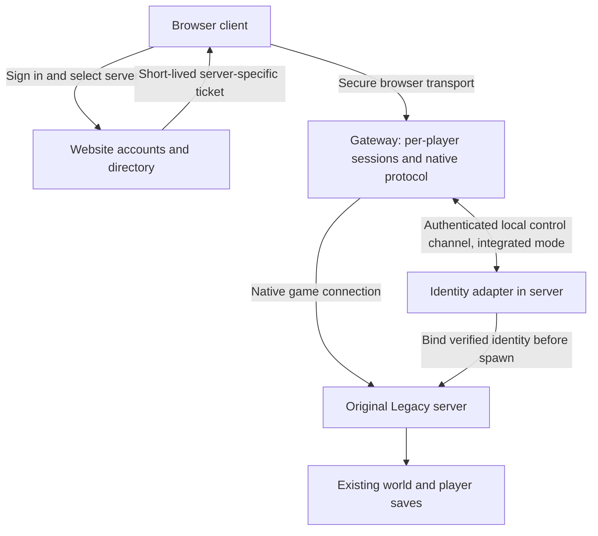

# Existing Legacy servers: investigation and delivery plan

Date: 17 October 2026. Owner: project owner. Status: researched proposal; no original-server join demonstrated.

This supplements [the accounts and hosting plan](HOSTING-ACCOUNTS-BRIDGE-PLAN.md). It concerns the original Legacy backend, not a replacement survival server. It does not change the game implementation currently being developed by Claude.

## Recommendation

The first-release decision is now **operator-installed gateway plus identity adapter**, with unchanged-server gateway research deferred. See [the first-release decision and join/link contracts](BROWSER-SERVER-DECISION.md). Keep the original server authoritative for the world, player saves and gameplay. The alternative modes below remain investigation options rather than prerequisites for release.

An unchanged-server route is conditional, not promised. A plugin is not automatically sufficient: its hooks must run early enough to authenticate and bind the connection before player creation. A controlled extension or version-specific server patch may be needed where a framework lacks those hooks. Do not promise a drop-in plugin for every server build.

## What the investigation establishes

| Finding | Evidence | Limit |
| --- | --- | --- |
| Supplied client sends protocol 1069, mode 2, UInt64 player ID, display name and authentication bytes | `analysis/client-connection.il.txt`; existing decompilation `analysis/decompiled/client/Assembly-CSharp/ClientConnect.cs`, `DoConnect` | Covers this supplied build, not every live community server |
| Server reads those fields, checks protocol, bans and duplicate identity before authorization | `analysis/server-connection.il.txt`; `ConnectionAcceptor.cs`, `uLink_OnPlayerApproval`; `ClientConnection.cs`, `ReadConnectionData` | Matching fields do not prove full uLink transport compatibility |
| Authorization calls native `Server.StartUserAuth`, waits for a result, and rejects failure/timeout | `analysis/server-authentication.il.txt`; `ClientConnection.cs`, `DoSteamAuthorisation` | A website login cannot simply replace this ticket on an unchanged server |
| Client/server uLink versions contain 1.5.6; client protection wraps sockets and can optionally encrypt | `analysis/SECURITY-COMPATIBILITY.md`; retained IL reports | No complete handshake, encryption or gameplay-wire equivalence proof |
| Desktop display name is separate from numeric identity | `ClientConnect.DoConnect`; `ClientConnection.ReadConnectionData` | The actual native ID derivation has not been established |
| Supplied community server notes describe static Steam-style IDs for emulator clients | `analysis/server-audit/LumaEmu.txt` | Packaging documentation, not observed behaviour; does not establish HWID derivation or ownership proof |
| Current multiplayer test is a custom HTTP movement harness | `tools/session-server.mjs`; `tools/check-multiplayer.mjs` | It is explicitly not uLink/1069 or an original-server integration test |
| Historical Legacy Oxide source exposes approval-related hooks | [Oxide Legacy hooks](https://github.com/OxideMod/Oxide.RustLegacy/blob/develop/src/RustLegacyHooks.cs), `IOnUserApprove`, `CanClientLogin`, `OnUserApprove` | Framework is archived; exact patch placement and compatibility with operator builds must be inspected and tested |

These conclusions use existing static analysis and source inspection. No supplied executable or DLL was loaded or run; no live community game server was contacted. Existing security observations are in `analysis/SECURITY-COMPATIBILITY.md`, not a verdict about all current servers.

## Connection modes and decision rules

| Mode | Server-owner changes | What must be proven | Decision |
| --- | --- | --- | --- |
| Hosted gateway to unchanged server | No server software change; owner cooperation for pilot | Native transport, legitimate per-player authentication, protection requirements and stable saves all work | Investigate first; offer only for specifically verified builds/auth profiles |
| Gateway plus identity adapter | Install compatible plugin/extension and configure trust | Verified website identity enters the native approval/save path without accepting arbitrary IDs | Preferred supported MVP if unchanged authentication is unavailable |
| Gateway plus gameplay adapter | Larger server extension exposing authoritative input/state | Enough original server internals are exposed safely, with correct visibility and actions | Consider only if reproducing native transport proves substantially harder; explicit cost/fidelity decision |
| Local helper on player's PC | Player installs a reviewed helper; server may remain unchanged | Supported native auth/transport available through helper | Optional future route; does not satisfy installation-free browser goal |

Cloud-streaming a desktop game is another architecture, with a desktop session/GPU stream per player. It is not the browser port being built and is not the proposed fallback.

## Proposed components

Separate the modules: browser transport, native protocol/session engine, admission verification, per-build adapter and server directory. A packet tunnel and a protocol translator are different: a tunnel requires the browser client to implement the native session protocol; the proposed initial gateway terminates that protocol itself and exposes versioned game messages to the browser. Either way, gameplay semantics, entity replication and client prediction must be implemented. Forwarding UDP alone will not make the current client interoperable.

Preferred deployment is a gateway beside each game server. We may host gateways regionally for unchanged-server trials or operators unable to host one. Central accounts/discovery should not carry every game's traffic. Each native player needs a distinct correctly tracked session/endpoint; never share one backend player between browser users. Remote gateways add latency and bandwidth cost. Servers will see gateway network addresses, so per-IP limits and IP bans need operator testing; do not claim a forwarded IP restores native identity.

## Desktop identities and existing progress

Official Steam identity and a community client's generated Steam-style identifier must be treated as different authentication profiles. Names are presentation, not ownership proof. We have not established that the supplied client uses HWID, nor that copying an installation or changing a name preserves its identity.

New browser accounts receive immutable platform UUIDs. In integrated mode, allocate a durable server-specific backend mapping; do not truncate UUIDs, invent legitimate Steam identities or silently collide with desktop accounts. First verify that the backend and plugins can distinguish and support the allocated namespace. If no safe namespace exists, choose a separately supported server profile rather than ship collisions.

Existing progress linking:

1. Player signs in to the website and requests a link for one specific server.
2. With an operator-installed adapter, issue a short-lived one-use challenge through a server command to the already authenticated desktop character. Redeeming it while logged into the website proves control of both sessions. A Steam OpenID link may additionally prove the Steam account, but must not be assumed to prove ownership of an unrelated emulator ID.
3. Atomically reserve the mapping after checking bans, duplicate links and active sessions. Preserve the old backend identity so inventories, building ownership and permissions remain attached to their original keys.
4. Reject conflicting claims and require an audited operator recovery process. Never auto-link by matching nickname, IP or a user-typed numeric ID.
5. Reauthentication is required for unlink/relink; unlinking must not let someone inherit the previous player's saves.

Without an adapter, preserve existing progress only if a verified native authentication path presents that same legitimate backend identity. Do not promise arbitrary save migration on an unchanged server. Inventory remains local to each world and subject to wipes.

## Authentication is the first gate

Steam OpenID can prove control of a Steam account for website linking; it does not issue the native game-session ticket expected by the inspected server. Modern Steam documentation distinguishes browser identity, native session tickets, and publisher/ownership APIs. These documents explain the boundary, not guarantee that the supplied old native API can use a modern flow.

For unchanged mode, document where a legitimate per-user ticket comes from in an installation-free browser workflow. If the only source is a native client/helper or unavailable publisher integration, record unchanged browser-only access as unsupported for that profile and proceed to the operator adapter. No shared Steam account, fabricated ticket, authentication downgrade or client-downloaded protection-code execution is part of the plan.

For integrated mode, the operator explicitly enables a separate browser admission mechanism. The adapter verifies platform-issued admission and binds it to one backend connection before player creation. Keep normal native-client authentication intact. Whether this requires an ordinary plugin, framework extension or controlled patch is an investigation result, not an assumption.

### Admission contract

- Central service issues an expiring, single-use ticket for a player UUID, server UUID, compatible client/gateway profile and unique join ID.
- Gateway validates and redeems it atomically, creates a pending backend session and an unpredictable per-connection binding nonce.
- Adapter validates admission through an authenticated local control channel and associates that nonce with the exact native approval/session. Binding cannot rely on source IP, nickname or user-supplied player ID. The exact encoding/hook is an implementation-gate deliverable.
- Only then resolve the persistent backend ID, apply server bans/capacity/policies and permit native player setup. Reject unknown/stale bindings.
- Use a server-scoped session lease for reconnect/takeover. Preserve intended native disconnect behaviour, clean up failed pending sessions and do not grant default items on every reconnect.
- Signing secrets stay on central services; server/gateway receive scoped credentials and verification keys. Use maintained crypto libraries, bounded key rotation and fail-closed handling of unverifiable new joins. Account-service downtime must not silently bypass admission; decide an explicit policy for existing verified sessions.

## Transport and gameplay compatibility work

Use secure WebSocket for an initial diagnostic spike because it is widely supported. It provides reliable ordered delivery and is not a substitute for UDP semantics. Define bounded queues, message lengths, sequence numbers and explicit channel behaviour. Record movement responsiveness under packet loss before treating it as a production choice.

Evaluate WebTransport datagrams/reliable streams for time-sensitive traffic after the basic spike. It requires a compatible secure endpoint and verified browser/provider support; it is not a browser socket directly to the old game port. WebRTC data channels are an alternative if justified by the support matrix, with signalling/ICE/TURN complexity explicitly costed. Select using measurements rather than promising one transport universally.

Native protocol inventory must cover: connection handshake/challenge, reliable/unreliable channels, sequencing/acks/retries, fragmentation/MTU, compression, protection/encryption negotiation, connection IDs, timeouts, approval payload, network views/entity IDs, interest/culling, spawn/despawn, RPC dispatch, serialization and disconnect cleanup. Match each to source evidence or an authorised trace. Reject unknown message IDs and malformed lengths; never expose a raw arbitrary-RPC pass-through.

After login, implement browser input and authoritative state for movement, inventory/loot, doors, gathering, wildlife, building, combat, death and respawn. Retain server validation; local prototype outcomes must not override server decisions. Test coordinate/rotation conversions, clock rates, interpolation, prediction reconciliation and ownership changes. Map/native gameplay message parity is a larger task than transport forwarding.

## Work packages and proof required

| Order | Work package | Concrete output | Exit gate |
| --- | --- | --- | --- |
| 1 | Compatibility dossier | One operator-supplied build/config profile: assembly hashes, protocol, native auth/protection, framework hooks, network ports and save keys | Identify exactly one supported pilot candidate; no claim about unnamed live servers |
| 2 | Auth and hook feasibility | Join sequence diagram; native-ticket feasibility verdict; adapter insertion/connection-binding specification | Demonstrate legitimate unchanged auth OR prove a scoped adapter can intercept before spawn; select mode |
| 3 | Protocol fixtures | Private packet/serialization catalogue with synthetic or redacted authorised traces and reproducible decoder tests | Handshake, approval and entity spawn independently decoded; errors bounded |
| 4 | Minimal gateway | Reviewed project-owned code, versioned browser messages, native session engine, limits and metrics | Browser-to-original-server approval, world load and one authoritative player spawn |
| 5 | Multiplayer slice | Two browser clients and, where supported, one native client in one original world | Mutual visibility, movement, door/loot interaction, disconnect/rejoin; original-server logs prove authority |
| 6 | Identity and persistence | Stable mapping, verified desktop linking, leases and consistent backups | Same identity/inventory/ownership after new browser, changed IP, restart and restore; failed impersonation/link tests |
| 7 | Gameplay parity | Original-server-backed interaction coverage and failure matrix | Gathering/building/combat/death/respawn reconcile correctly; no client-authoritative inventory grants |
| 8 | Operator package and directory | Versioned gateway/adapter, validation command, install/rollback guide, ownership enrolment, health/compatibility listing | Second independent host installs and joins successfully; regular native players still work |
| 9 | Limited public pilot | Measured capacity/support profile, monitoring and incident/recovery procedure | Load, latency, failure and abuse gates met before wider listing |

Steps 1–3 now target the integrated adapter route first, as specified in the decision document. Do not build the full account portal or advertise arbitrary server compatibility before their go/no-go decision. Self-authored transport mocks can run on the current PC; they must remain labelled mocks.

## Operator installation experience

The intended package includes a gateway service, a precisely versioned server adapter where required, example configuration, build compatibility manifest, diagnostics, upgrade and rollback instructions. Names are provisional; no package is released yet.

Operator flow:

1. Create a server-owner account; enrol a stable server UUID and prove control through an authenticated ownership challenge.
2. Back up world saves/configuration and existing player/permission mappings using a consistent-save procedure. Record native build/framework hashes.
3. Install the supported gateway and, for integrated mode, the matching plugin/extension. Reject unsupported combinations rather than patching blindly. Keep ordinary native join ports operating under their existing policy.
4. Configure an HTTPS/WSS endpoint and certificate, allowed project origins, exact native backend address and server-scoped credentials. If WebTransport is selected, also expose its required secure UDP endpoint. Avoid sending game traffic through a CDN that does not support the selected transport.
5. Restrict the adapter control channel to local authenticated IPC or mutually authenticated private transport. Backend destinations are configured by operators, never chosen freely by browser packets; block the gateway becoming an open UDP relay or internal-network proxy.
6. Run diagnostics and the two-player smoke test on a pilot clone. Check bans, admin permissions, anti-cheat policy, native clients and save restoration.
7. Publish the registered endpoint and advertise only verified version/capability flags. Directory heartbeats expire stale listings; distinguish browser-ready from merely online Legacy servers.
8. Upgrade through a tested compatibility window; rollback both gateway and adapter together. Keep player mappings and world backups. Never imply rollback reverses an incompatible save migration without a restore.

Shared hosting must permit the gateway process, required ports and adapter. If it does not, offer a separately hosted nearby gateway, still with the adapter where auth requires it, or use a provider that supports the package.

## Acceptance and operating measurements

- Reject wrong-server, expired, forged and replayed tickets; test concurrent redemption, stale leases and cross-account takeover attempts.
- Preserve native-client behaviour, bans, allowlists, capacity rules and minimum exposure of player information. Browser clients cannot be assumed to run native anti-cheat; operator policy must explicitly support them without claiming equivalent protection.
- Test two people behind one NAT/gateway and two sessions claiming the same identity. They must not merge or evade duplicate rules.
- Test 50/100/200 ms added latency and 0/1/3/5 percent loss, reconnects, reordered/duplicated messages, background-tab throttling and slow receivers. Record input-to-authoritative-update p50/p95, bytes per player, CPU/memory and disconnects. These are proposed scenarios, not achieved performance.
- Load first at 2, then 10 and 25 simultaneous players; increase only when measurements justify it. Measure per-player buffers and all process resource ceilings. No player-capacity promise exists yet.
- Backup/restore includes server UUID, identity mappings, consistent world/player saves and compatible adapter version. Do not log raw auth tickets or credentials in traces.
- Estimate bandwidth from measurement: total bidirectional kB/s per player × average concurrent players × seconds / 1,000,000 gives decimal GB, before provider accounting and overhead. Regional gateway forwarding may incur separate egress charges. Website/CDN costs are separate from game traffic.

## Test environment and remaining unknowns

No isolated native test host is available yet. The existing prohibition on executing the supplied client/server packages on this PC remains in force. This plan does not require spending money or contacting operators now. Use a permitted isolated test environment or an operator-authorised staging server before original binary execution/live trials; do not test intrusive probes against public servers.

Unknowns to resolve: actual builds/auth/protection of servers the user has in mind; legitimate browser-only native ticket availability; sufficient early hooks; safe backend ID namespace; complete protocol/schema and RPC surface; native anti-cheat expectations; runtime compatibility of a reviewed adapter; measured transport performance; and distribution arrangements for a public playable client.

Until a pilot exists, the accurate status is **gateway design investigated; Legacy-server interoperability unproven**. Full replacement server development is not implicitly authorised by failure of a gateway experiment.

## Immediate handoff for implementation

Start with one build profile and trace `ClientConnect.DoConnect` → native ticket generation → uLink connect → `ConnectionAcceptor.uLink_OnPlayerApproval` → `ClientConnection.AuthorisationRoutine` → native auth result → player creation/save identity. Use retained IL to check decompiler ambiguities. Inspect the archived Oxide patch definitions against this exact path before choosing hooks. Specify the pending-session nonce binding and normal-native-client separation. Produce the auth feasibility verdict before implementing an accepting endpoint.

Do not execute original binaries on this PC, disable global server authentication, fetch/run protection payloads, publish raw third-party source/assets, or replace this investigation with a successful custom HTTP harness result.

## Auth feasibility verdict (static, 17 October 2026)

**Verdict: feasible with an operator-installed adapter; not feasible on an unchanged server.** Evidence is the user's decompiled server `Assembly-CSharp` (`analysis/decompiled/server/`, uploaded as private release `data-1`) plus the client's `ClientConnect.DoConnect`. The archived Oxide repository's reference `Assembly-CSharp.dll` (SHA-256 `ce0dd832…acfbb`) decompiles to the same `ConnectionAcceptor`/`ClientConnection`/`ServerManagement`/`NetUser`/`BanList` logic: the only differences are decompiler naming. Nothing was executed; no live server was contacted.

### Native join sequence (this build)

1. `ConnectionAcceptor.uLink_OnPlayerApproval(approval)`: deny if `m_Connections.Count >= server.maxplayers` → `new ClientConnection().ReadConnectionData(approval.loginData)` reads `Int32 protocol`, `Byte mode` (must be 2), `UInt64 UserID`, `String UserName`, `Bytes SteamTicket` → deny unless protocol 1069 → deny if `BanList.Contains(UserID)` → deny `AlreadyConnectedToAnotherServer` if `IsConnected(UserID)` (pending and connected `ClientConnection`s; **vanilla never kicks the existing session**) → `m_Connections.Add`, `StartCoroutine(AuthorisationRoutine)`, `approval.Wait()`.
2. `ClientConnection.AuthorisationRoutine`: `DoSteamAuthorisation` → `Server.StartUserAuth(UserID, SteamTicket)` → native `librust` `SteamServer_BeginAuthSession`; then waits up to 10 s for the native `OnUserAuth` callback status `ok`. If `Server.SteamGroup != 0`, `DoSteamGroupTest` requires native group membership. Then `approval.localData = this` and `approval.Approve(...)` with a BitStream of `Globals.currentLevel`, `NetCull.sendRate`, `server.hostname`, `Server.Modded`, `Server.Official`, `Server.SteamID`, `Server.IPAddress`, `server.port` (all public statics).
3. `uLink_OnPlayerConnected`: `NetUser` built from `ClientConnection.UserName`/`UserID` (group REGULAR); `CreatePlayerClientForUser`, `OnUserConnected`. Character load: `NetUser.LoadAvatar` → `ClusterServer.LoadAvatar(userID)` reads `server.datadir + "userdata/<UserID>/avatar.bin"` (empty avatar if absent). Structures and deployables store `OwnerID`/`CreatorID` as the same UInt64.
4. Disconnect or denial: `Server.OnUserLeave(UserID)` → native `SteamServer_UserLeave`.

### Consequences for the adapter

- **Identity is only the UInt64 `UserID`.** Saves, ownership and bans key on it, and no managed code checks that it is in the Steam range. A browser identity therefore works for persistence once approval succeeds, and a linked desktop character keeps its saves by reusing its existing ID. New-ID namespaces must avoid existing `userdata/<id>` folders, ban-list entries and plugin data, because a collision silently gives someone else's character. In vanilla, admin rights come from `rcon.login`, not from an ID list.
- **The only native ticket check is `StartUserAuth`/`BeginAuthSession` inside `AuthorisationRoutine`.** An unchanged server cannot admit a browser player without a ticket that the native `librust` (or LumaEmu in the community package) accepts. That path stays out of scope: no fabricated tickets.
- **Insertion point.** Ban and duplicate checks run natively against the claimed `UserID` before any coroutine, which matches the adapter's rule of never displacing a live session. The browser branch must replace only the `DoSteamAuthorisation` step for connections whose `SteamTicket` is a valid `RLBA` envelope, and must deny it if `Server.SteamGroup != 0`, because browser identities cannot satisfy Steam group whitelists. Everything else (world-info approval, NetUser setup, avatar load) stays native.
  - *Vanilla server:* a small version-specific patch in `AuthorisationRoutine` (or `uLink_OnPlayerApproval`'s final branch) calling the adapter.
  - *Oxide server:* `IOnUserApprove` (patched into `uLink_OnPlayerApproval`, args ClientConnection/approval/acceptor; a non-null return exits before `m_Connections.Add`) gives a plugin enough access to verify the envelope, `acceptor.m_Connections.Add(connection)`, set `approval.localData` and `Approve` with the same eight public fields. **However, Oxide's own `IOnUserApprove` kicks any existing session with the same UserID before plugins run** (`RustLegacyHooks.cs`), unlike vanilla. A plugin-only Oxide adapter is acceptable only because the gateway registers a pending session after the adapter confirmed no live lease. That leaves a race window, so a pilot should prefer a patched Oxide core or the vanilla patch. The exact IL position of Oxide's hook (index 49) has not been re-checked against the retained IL; the inference that it precedes the native `IsConnected` check comes from that kick logic.
- **Envelope size:** the client allocates a 1024-byte ticket buffer and writes `GetAuth`'s actual length with `WriteBytes`, so the 53-byte envelope is well within what the field already carries.

### Still unresolved

- ~~Native `SteamServer_UserLeave`~~ **Inspected statically (objdump, no execution), 17 October 2026.** In server `librust.dll` (`rust_server_Data/Plugins`, 854,016 bytes), export `SteamServer_UserLeave` (RVA `0x82d0`) calls the `steam_api.dll` import `SteamGameServer()`. If that returns an interface, it decrements a global counter (`0x100ca5dc`) and calls two interface methods with the 64-bit ID, at vtable offsets `0x78` and `0x68`. `SteamServer_BeginAuthSession` (RVA `0x81e0`) increments the same counter whenever the interface exists, then calls offset `0x74`. Nothing else references the counter, so a browser player who never began a Steam session only makes it drift, with no effect. The offsets match the Steam game-server interface layout (`BeginAuthSession` 0x74 → `EndAuthSession` 0x78; `SendUserDisconnect` 0x68). Real Steam ignores both calls for an unknown ID. The community package's LumaEmu `steam_api.dll` implementation of those two methods has not been inspected (residual risk: low).
- The uLink transport and handshake the gateway would speak (uLink assemblies are not in the decompiled set). The approval reply format above is known; the connection protocol is not.
- Live proof in a permitted isolated environment (decision document step 4) remains outstanding.

### Vanilla (non-Oxide) patch specification

For servers without Oxide, a version-specific patch replaces only the Steam ticket step for envelope logins. Same contract as `adapter/RustLegacyBrowser.cs`, so the Oxide kick race does not exist here.

- **Target:** server `Assembly-CSharp.dll` of this build (record its SHA-256 before patching; refuse any other build). Patch method `ClientConnection.AuthorisationRoutine(NetworkPlayerApproval)`.
- **Change:** at the start of the `if (ConnectionMode == 2)` block, if `SteamTicket` starts with `RLBA`:
  1. refuse if `Server.SteamGroup != 0`;
  2. call the sidecar (`/plugin` `approval`, as the plugin does) and wait inside the coroutine (`yield return null` until the reply or 5 s);
  3. on approval, skip `DoSteamAuthorisation`;
  4. on refusal or timeout, call `DenyAccess(approval, "browser admission refused", NetError.Facepunch_Connector_Cancelled)` and `yield break`.
  
  Everything after (Steam group test, approval BitStream, `approval.Approve`) stays native. Ban and `IsConnected` checks have already run in `uLink_OnPlayerApproval`, and vanilla refuses duplicates without kicking.
- **Lifecycle hooks:** `uLink_OnPlayerConnected` (native players → `native-authenticated`), `uLink_OnPlayerDisconnected` (`disconnect`), and a console/chat command for `/browserlink`. These can live in a small `MonoBehaviour` added beside `ServerManagement` by the same patch.
- **Delivery:** IL patching with a reviewed, project-owned patcher (e.g. Mono.Cecil) run by the operator on their own copy. Keep the original for rollback. Never redistribute patched game assemblies.
- **Built (2026-10-17), not yet run on a server:** `adapter/vanilla/RustLegacyBrowserVanilla.cs` (`RustLegacyBrowser.Vanilla.dll`, same sidecar contract as the Oxide plugin; HTTP on a worker thread, callbacks on a main-thread `Pump`; config `<datadir>/cfg/rustlegacybrowser.cfg`) and `tools/vanilla-patcher` (Mono.Cecil; `check|patch|verify|restore`; SHA-256 allowlist; backup). Design change from the first draft: instead of editing the compiler-generated `AuthorisationRoutine` state machine, the patch adds one call before `m_Connections.Add` in `uLink_OnPlayerApproval` (after the native ban and duplicate checks, like Oxide's `IOnUserApprove` but without its kick) and the adapter answers the approval itself with the same eight world-info fields, as the Oxide plugin does. Branches that targeted the insertion point are retargeted to the hook. Verified by decompiling the patched copy with ILSpy: the four methods read exactly as intended and nothing else changed; `restore` returns the original hash. Still needs a permitted test host for a live join.

## External references checked

- [Steam authentication and ownership](https://partner.steamgames.com/doc/features/auth): distinct website OpenID, session-ticket and ownership flows; not confirmation of this old package's native API behaviour.
- [Steam game-server API](https://partner.steamgames.com/doc/api/isteamgameserver): ticket verification lifecycle and API constraints.
- [MDN WebSocket](https://developer.mozilla.org/en-US/docs/Web/API/WebSockets_API): browser transport support and buffering limits.
- [MDN WebTransport](https://developer.mozilla.org/en-US/docs/Web/API/WebTransport_API): HTTP/3 endpoint and stream/datagram capabilities.
- [Archived Oxide Legacy framework](https://github.com/OxideMod/Oxide.RustLegacy): Legacy-specific integration source; archived in 2019, not modern Rust plugin compatibility.
- [Oxide Legacy approval hooks](https://github.com/OxideMod/Oxide.RustLegacy/blob/develop/src/RustLegacyHooks.cs): candidate hook evidence only, not proof that a plugin alone replaces native authentication.
