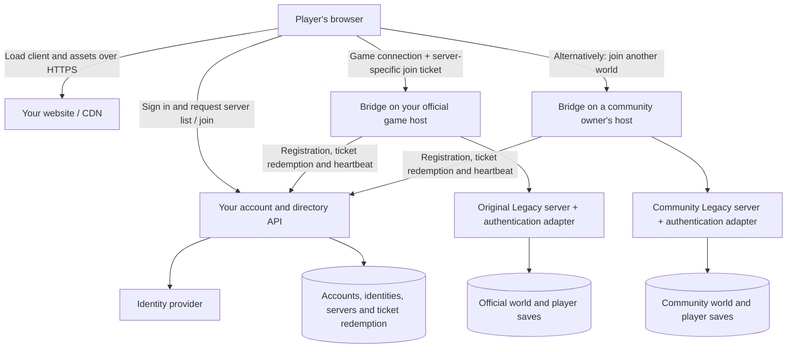

# Rust Legacy Browser: accounts, bridge and hosting plan

Date: 17 October 2026  
Status: proposed architecture and implementation plan; not a claim of deployed features.  
Scope: planning only. This document does not change the game code being developed by Claude.

Existing-server integration is expanded in [the investigation and delivery plan](EXISTING-SERVER-INTEGRATION-PLAN.md), covering conditional unchanged-server gateways, operator adapters, desktop identity linking and explicit compatibility gates.

The [first-release decision](BROWSER-SERVER-DECISION.md) selects gateway plus operator-installed adapter as the supported route. Unchanged-server access is later research, not a release dependency.

## 1. Recommended arrangement

Players visit one main website, sign in, open the familiar server browser and join an independently hosted world. You operate the website, identity service and server directory. You can also operate official game servers. Community owners operate their own game servers with our bridge/adapter package.

The preferred gameplay backend is the original Legacy server, provided the compatibility investigation proves that it can authenticate browser players and exchange the required game messages correctly. A browser connection bridge is not yet proven to accomplish that. A replacement gameplay server is a separate, much larger fallback decision, not an assumed part of this plan.

Recommended public MVP:

- Website/client/assets on HTTPS static hosting with a CDN.
- One small central application for account integration, server registration and join tickets; one persistent PostgreSQL database.
- An established OpenID Connect identity provider for sign-in, recovery and MFA. Select the maintained provider during implementation; do not build password handling or cryptography from scratch.
- One separately hosted official game server with a colocated bridge and server authentication adapter.
- Add community hosting only after the official server passes identity, gameplay and save/reconnect tests.

The logical services can share infrastructure where appropriate. Keep the original game process separate from account/database credentials and central infrastructure. The website does not need to run a separate copy of the game for every visitor: graphics execute in the player's browser and the selected game server runs the authoritative world.

## 2. How the parts connect

The browser connects directly to the selected server's bridge. Normal gameplay traffic does not pass through your website/API. Your central service handles identity and discovery, rather than carrying every server's game traffic.

An example deployment uses `play.example.com` for the game website and `api.example.com` for the central application. Each game server has its own registered secure bridge endpoint. These are illustrative names, not selected domains or provisioned services.

## 3. Player accounts and permanent identity

Account creation is required to join through the browser client. The public website/server list may remain browsable without signing in.

On first verified sign-in, create an immutable random platform player UUID. Map the authentication provider's `(issuer, subject)` identity to that UUID. Email, display name, IP address, browser storage and current login sessions are not player identifiers.

Rules:

- Changing email, display name, IP, browser or computer does not change the platform player UUID.
- Logging out invalidates the login session; it does not delete the account or character saves.
- Account recovery must restore the same platform player UUID, not create a fresh game identity.
- Linking a second login provider requires proof of control of both identities. Do not automatically merge accounts by matching email or display name.
- Protect account linking/recovery changes and server ownership with reauthentication; require MFA for platform administrators and server owners.
- Do not allow removing the last working sign-in method without an established recovery method.
- Keep sign-in identity separate from the public display name. Community servers receive the minimum identity claims they need, not passwords, email addresses or identity-provider refresh tokens.

Use OpenID Connect authorization code flow with PKCE through maintained libraries. Keep long-lived login credentials server-side, with a Secure, HttpOnly, appropriately SameSite website session cookie. Apply CSRF protection to session-authenticated changes. Do not persist bearer join tickets or provider tokens in browser localStorage.

Sources for the authentication design: [OpenID Connect Core](https://openid.net/specs/openid-connect-core-1_0.html), [PKCE, RFC 7636](https://www.rfc-editor.org/rfc/rfc7636.html). The choices above are this project's proposed policy, not claims that those standards implement the whole game-account system.

## 3a. One account per person (owner decision, 22 Oct 2026)

Everyone must be able to play, including cracked desktop clients without Steam: Steam is **never** required by default. One account per person is approached with layered identity instead (`central/identity.mjs`):

- **Sign-up**: email + password, or Steam. Throwaway email domains are refused (a list file re-read on change, plus staff additions). Addresses are canonicalised (lowercase, `+tag` dropped, Gmail dots dropped, googlemail.com = gmail.com): one mailbox, one account.
- **Identifiers**: canonical email, Steam ID, verified phone, browser device token, desktop hardware ID, each stored as HMAC-SHA256 under the central pepper (`central_meta`, or `identity.pepperFile` in the central config). Raw values are never stored (the email stays on the player row as before; the phone number is held in memory for its 10-minute code only).
- **Owner decision (29 Oct 2026)**: Discord sign-in and account-linking removed — "People can just login using their login from our website or steam." The Discord OAuth provider, the Discord column in the admin "possible alt" reasons, and Discord as a ban-identity signal are gone; sign-in is email/password or Steam only. The project's own Discord server (community link, #server-status bot, host alerts) is unaffected.
- **Browser device signals** (admin notes only): an HttpOnly `rlb_device` cookie with a localStorage copy (each restores the other), a hash of UA/screen/timezone/WebGL/language, the IP hash (IPv6 by /64) and a hosting/VPN label from `central/data/hosting-ranges.txt`. Sightings are kept 12 months after last seen; play sessions 6 months.
- **Linked-identity bans**: an active ban covers every identifier of the banned account at join time; hard identifiers refuse, a shared device holds for review; holds are audited and clearable; unban lifts them all (ANTICHEAT-ADMIN-PLAN "Account-level bans").
- **Per-server opt-in**: minimum account age, verified phone, Steam, Steam quality thresholds. Shown in `GET /servers` `requirements` (`minAccountAgeMinutes`, `phone`, `steam`, `steamQuality`).
- **Desktop hardware ID** (contract, DESKTOP-LAUNCHER-PLAN.md "Hardware ID"): the launcher sends `hwid: "v1:" + base64url(SHA-256(...))` with `/desktop/login`, `/desktop/device/token` and each pass request; central keeps only its HMAC as identifier kind `hwid`.

Config (`tools/central.mjs`): `identity:{pepperFile?, disposableDomainsFile?, hostingRangesFile?}`, `phone:{provider:"console"}`, `steam.apiKeyFile` (also enables the Steam quality checks), `screenshots:{retentionDays}`.

## 4. What gets saved, and who owns it

| Information | Persistent authority | Key |
| --- | --- | --- |
| Website account and linked sign-in identities | Central database | Platform player UUID |
| Display name, account status and server favourites | Central database | Platform player UUID |
| Server ownership, endpoint and supported versions | Central database | Stable server UUID |
| Website-player to legacy-player identity mapping | Persistent identity mapping, with a protected adapter copy as needed | Server UUID + platform player UUID |
| Character inventory, position, health and world progress | Selected authoritative game server's save system | Stable mapped legacy identity within that server/world |
| Buildings and world objects | Selected game server's save system | Original world ownership/object identifiers |
| Local server bans and rules | Individual server | Stable player identity |
| Platform account suspension/directory admission policy | Central service | Platform player/server UUID |

Inventories are per server. A player has one website identity but separate progress on Server A and Server B. There is no cross-server item transfer in the MVP. Never restore inventories from a player's browser-supplied save file or localStorage.

Logging out must preserve Legacy's actual disconnect/sleeping-character behaviour, once ported and verified. Do not delete the character merely because a socket disconnects. Reconnect must attach to the existing identity/character, rather than granting the default loadout again.

A game-server wipe can reset world progress while leaving website accounts and identity mappings intact. Give each world an explicit generation/wipe identifier and display wipe policy in the server list. Reinstalling or moving a server should preserve its stable server UUID, identity mappings and world saves; it must not silently create a different identity namespace.

Server operators must keep consistent world-save backups and the associated identity mapping. Back up central account/mapping data separately. Test restoring both together: a world backup without a usable identity mapping is not a successful recovery. Use the original server's supported consistent-save/snapshot procedure; copying live files arbitrarily is not a reliable backup plan.

## 5. Securely joining a server

Proposed join sequence:

1. The player signs into the website and selects a registered server.
2. The central API checks account status, server status, supported client version and applicable access rules.
3. It issues a narrowly scoped signed join ticket, with a proposed lifetime of about 60 seconds.
4. The browser opens a secure connection to that server's registered bridge. With WebSocket, send the ticket as the first application message; the [browser WebSocket constructor](https://developer.mozilla.org/en-US/docs/Web/API/WebSocket/WebSocket) exposes URL/subprotocol parameters rather than arbitrary request headers. Keep tickets out of URLs, referrers and logs.
5. The bridge verifies the pinned issuer, permitted signing algorithm, signature, expected ticket type, expiry, server audience and compatible protocol/build.
6. The bridge authenticates to the central API using its own per-server credential and atomically redeems the ticket's unique ID. Only the intended server may redeem it, and only once. This prevents replay even when multiple bridge processes serve the same server.
7. The server-side adapter resolves the permanent website identity to the server's supported legacy identity, authenticates the player and restores that character's saved state.
8. The bridge and game server acknowledge the join. Client input can then reach the authoritative world.

Ticket claims should include: issuer, opaque player ID, intended server UUID/audience, unique ticket ID, issued/expiry times, ticket type and protocol/build compatibility. A display name may be included for presentation but cannot grant permissions. Never accept a client-supplied account role, Steam ID, inventory or authoritative position.

Allow only approved website origins at the browser-facing bridge, cap unauthenticated connections and require admission within a short timeout before forwarding game messages. Origin checks complement ticket verification; they do not replace it. The website's content security policy must also permit the selected registered bridge. A per-server play route can issue a policy for that validated endpoint without trusting an arbitrary URL supplied in a query string.

Use asymmetric signatures: the central service holds the private signing key; community bridges receive verification public keys. A community host must not receive a shared secret that lets it issue player tickets for other servers. Use explicit key rotation and revocation, with trusted key-discovery locations. Do not fetch verification keys from arbitrary URLs inside untrusted tokens. Follow [JWT Best Current Practices, RFC 8725](https://www.rfc-editor.org/rfc/rfc8725.html).

Ticket redemption is online at admission. If the central admission service is unavailable, fail new joins clearly; do not silently create guest identities. Existing accepted game connections should continue when practical. Specify and test how account/server revocations reach already connected sessions; ticket expiry alone does not disconnect an established session.

Prevent accidental duplicate characters with an explicit per-server player session lease/reconnect policy. Reconnection may replace a stale connection after verifying the same permanent identity. Do not use an IP address as a duplicate-session key.

## 6. The bridge and original-server adapter

The hosting package has distinct responsibilities:

**Browser-facing bridge:** accepts the supported browser transport, validates admission, enforces limits, tracks connections and translates messages to/from the supported gameplay backend. Secure WebSocket is a reasonable initial transport candidate, subject to gameplay latency/load tests. Its ordered reliable delivery is not equivalent to Legacy's UDP networking; sequencing, message channels, packet sizing and timing need explicit handling. If performance requires a different browser transport, validate it before changing the contract. [WebSocket API documentation](https://developer.mozilla.org/en-US/docs/Web/API/WebSockets_API)

**Original-server authentication adapter/plugin:** securely binds the verified website identity to the character identity accepted by the original server, then integrates with its native save/ownership systems. A transport proxy alone does not supply an authentication or identity solution.

**Local state/configuration:** keeps stable server identity, adapter mappings/caches, supported build information and operational settings. It does not contain the central signing key or users' website passwords.

Compatibility requirements to prove:

- The original server accepts the chosen authenticated identity through a supported adapter path.
- The browser client can complete a real connection, load a world, control a character and receive authoritative updates.
- Two players interact in the same original-server world correctly.
- Inventory, ownership and character state survive reconnect, IP changes and a server restart.
- Native authentication/protection dependencies can be handled without loading unreviewed downloaded code or fabricating third-party credentials.
- Client and server gameplay messages, save format and any selected original builds are compatible.

Do not truncate a 128-bit platform UUID into a native 64-bit ID and assume uniqueness. If the backend requires another identifier format, use an allocated, collision-checked, persistent mapping accepted by the adapter's verified authentication path. Do not claim invented IDs are legitimate Steam identities. Linking an existing native account/progress requires verified ownership and a deliberate migration process, not matching names or IP addresses.

If original authentication cannot support this safely/correctly, stop at that compatibility gate and decide between a supported plugin integration, a constrained officially hosted mode or a larger server port. Do not conceal the limitation behind the existing local transport test harness.

## 7. Hosting official and community servers

The same package should support your official server and third-party servers. Each server/world instance has its own registered identity and credentials, even when several run on one physical machine.

For an original Windows-only server build, use a compatible Windows game host. Do not promise Linux/container support for the original executable until verified. The bridge can be implemented portably, but its native backend still determines the game-host requirements.

Server-owner installation flow:

1. Create a verified owner account and register a server name/region.
2. Install our versioned bridge/adapter package and supply an authorised compatible original server installation.
3. Configure the world/save directory, native server port and browser-facing endpoint.
4. Use a short-lived owner bootstrap code to enrol this instance and obtain its per-server credential. Rotate/revoke that credential without changing the stable server UUID.
5. Provision HTTPS/WSS and demonstrate endpoint ownership. Owners may use their own domain; an optional project-managed subdomain can simplify deployment later.
6. Run configuration/version checks, perform a test join and register authenticated heartbeats.
7. Publish the server listing after checks pass.

For browser-only hosting, bind the native game interface to loopback/private networking where supported; expose the secure bridge. A mixed native/browser server may additionally expose the original native port, but coexistence and identity linking are additional compatibility tests. Do not promise that arbitrary unchanged online Legacy servers will work.

Community owners store and control their own worlds. Their server can enforce its own rules and local bans, but cannot create or modify players' central accounts. Registration is not a guarantee that an independent owner will preserve saves or operate fairly. Present server ownership clearly to players.

Distribute our own bridge, adapter, configuration tools and documentation. Confirm distribution permissions for original assets/software and branding before public release; do not automatically include the supplied community packages or recovered copyrighted files in a public hosting bundle.

## 8. Server directory

Directory records should include stable server ID, owner, display name, region, registered bridge endpoint, supported versions, capacity, player count, wipe generation/date, access/password policy and last heartbeat.

Proposed starting policy: a signed/authenticated heartbeat about every 15 seconds; mark unavailable after roughly 60 seconds without one. Tune those values after operational testing. Player counts reported by a community server are claims, not proof for security or billing decisions.

Only registered compatible endpoints appear in the initial public list. Verify endpoints/version support and allow owners to rotate credentials or move hosts. Never treat registration input as permission for unrestricted network fetching: restrict any health-check connections against private/internal destinations and DNS rebinding. Prefer authenticated outbound heartbeats and controlled endpoint verification.

Show clear join failures for offline/full servers, bans, required versions, account status and failed authentication. Do not let the directory's server ID change just because the server's IP changes. Display latency only from a measured browser/bridge path, not a fabricated value or an assumed UDP ping.

## 9. Central data and interface contracts

Start with one application and one database, not a large collection of independent services. Separate responsibilities in code so they can be split later if load requires it.

Suggested persistent records:

| Record | Important constraints |
| --- | --- |
| players | Immutable platform UUID; account status; display name separate from identity |
| login_identities | Unique issuer + subject; linked platform player UUID |
| servers | Stable UUID; owner; registered endpoint; protocol/build compatibility; listing state |
| server_credentials | Per-instance identity; hashed/public credential material; rotation/revocation metadata |
| legacy_identity_mappings | Unique server/player pair and unique native identity within the backend namespace; durable across moves/restarts |
| join_ticket_redemptions | Unique ticket ID; intended server; expiry; atomic redemption; no raw bearer ticket |
| player_session_leases | Server/player identity; connection generation; expiry/reconnect status |
| audit_events | Account/security/owner changes without passwords, auth tickets or signing keys |

Suggested API responsibilities (paths are draft contracts):

- Website session/account endpoints backed by the identity provider.
- `GET /servers` for the public compatible server list.
- `POST /servers/{id}/join-ticket` for authenticated admission requests.
- Owner-authorised server registration/update/enrolment endpoints.
- Server-authenticated ticket redemption, identity resolution and heartbeat endpoints.
- Restricted administration for account/server suspension and credential rotation.

The browser never has direct database access. Community servers authenticate as their own server instance and cannot query other servers' mappings or redeem another audience's tickets. Keep account administration, owner permissions and ordinary player permissions distinct.

## 10. Operations and recovery

Before public access, establish automated central backups and consistent game-world backups, then perform an actual restore test. Keep server credentials and identity mappings recoverable without publishing them. Specify retention and account-deletion responsibilities for central and independently hosted data.

Monitor login/join failures, ticket redemption, server heartbeat loss, active connections, bridge latency/queues, game tick performance, save failures and disk capacity. Redact secrets and minimise unnecessary IP/user data. Define a retention policy before launch.

Version the browser client, bridge and adapter together with explicit compatibility information. Permit staged releases and a known-good rollback. Test save compatibility and take a consistent pre-update backup before changes that affect persistence. Do not silently wipe progress on a failed upgrade.

Set capacity from measured CPU, memory, bandwidth, tick/latency and save performance. No honest player-count or monthly-cost commitment can be made from the present local prototype alone. Start with one region and one official server, then size the public service using those measurements.

## 11. Implementation order and acceptance gates

| Phase | Deliverable | Required proof before progressing |
| --- | --- | --- |
| 0. Compatibility investigation | A minimal browser-to-original-server adapter spike and a documented identity/authentication path | A real supported native server accepts a stable identity and exchanges enough authoritative state for a world/character session. The HTTP local harness alone is not this proof. |
| 1. Accounts and identity | OIDC sign-in/recovery, permanent UUIDs, role separation, durable mapping schema | Logout, new browser, changed IP, recovery and verified provider linking retain the same player UUID. Unverified linking and account impersonation fail. |
| 2. Secure admission and bridge | Signed one-use join tickets, per-server enrolment, translation and adapter authentication | Real joins work; forged/expired/replayed/wrong-server tickets fail. A community server cannot impersonate another server or issue central player identities. |
| 3. Official server and saves | One hosted world with consistent persistence/backups | Two real browser players interact; reconnect and restart preserve inventory/ownership as Legacy intends. A restore test recovers the world and the matching identities. |
| 4. Directory and community package | Owner portal, heartbeat directory, installer/config validation | An independently configured second host registers, accepts a join and restores the same player's own local progress. Server IP migration and credential rotation work. |
| 5. Public MVP | Website play flow, monitored hosting, staged updates and documented limits | Version, capacity, fault/recovery, account and security acceptance tests pass. Asset/software distribution permissions and user-facing policies are resolved. |

Account contracts, mock adapters and browser-only multiplayer can be developed/tested on the current PC. Original client/server binaries remain prohibited on this PC under the existing instruction; native integration tests require a permitted test environment or a later explicit change to that instruction. The user has said no isolated test host is available yet. This limits proof of the original-server route, not the ability to build/test our own account and bridge components.

Do not buy large hosting capacity or advertise compatibility with existing community servers before the compatibility and persistence gates pass.

## 12. Final acceptance checklist

- A returning user keeps the same identity after logout, a new IP, a new browser, changed display name/email and account recovery.
- Account A cannot load Account B's character by submitting a different player ID or display name.
- Server A cannot redeem Server B's tickets or change central accounts.
- Ticket replay fails across both repeated requests and multiple bridge instances; private signing keys never leave central custody.
- Reconnects do not duplicate characters/items or grant repeated starter loadouts.
- Two simultaneous players receive authoritative world/gameplay updates from the same original server.
- Inventories and buildings persist through a server restart and a tested backup restore.
- Server A and Server B keep independent inventories for the same website account.
- A wipe resets the intended world progress while preserving the website identity and stable mapping.
- A game-host IP change or credential rotation does not create a new player/server identity.
- Central admission outage blocks new joins clearly while accepted sessions behave according to the documented policy.
- Directory expiry, full/banned/offline/version errors and failed saves are visible and actionable.
- The bridge rejects invalid/oversized/flooded messages and applies server authority instead of trusting browser inventory or position claims.
- Public release states exactly which server builds, transports and gameplay features are supported; test-harness results are not described as original-server compatibility.

The intended player experience is: **sign into the website, choose an official or community server, play, and return to the same server later with the same account and saved character.**
