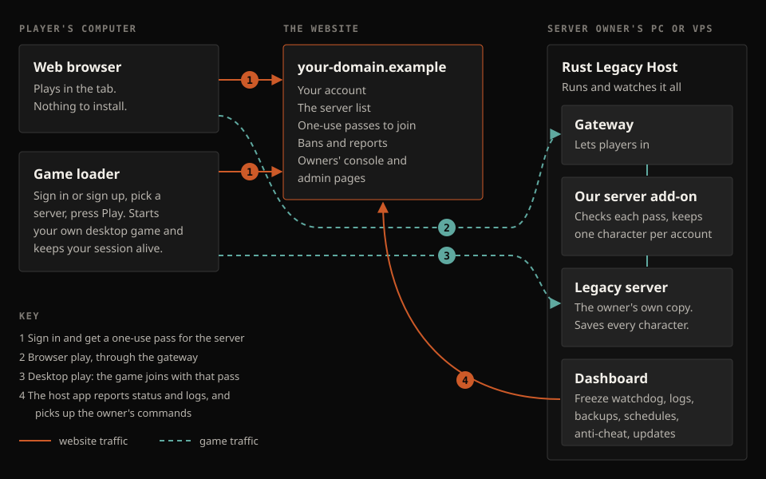

Rust Legacy Browser has four parts. Players use the first two, server owners run the third, and the website joins them all together.

| Part | Who uses it | What it does |
| --- | --- | --- |
| **The website** (your-domain.example) | Everyone | Your account, the server list, the one-use passes that let you into a server, bans and reports, and the owners' console |
| **The browser game** | Players | The game, in a browser tab. Nothing to install |
| **The game loader** | Players on the desktop game | Signs you in (or creates your account), lets you pick a server and starts your own copy of the desktop game |
| **Rust Legacy Host** | Server owners | Installs on the owner's PC or VPS and runs their Legacy server with our gateway and add-on, with a dashboard for everything else |

## One account, everywhere

You need a website account to play. You can make one on the website or in the game loader, in under a minute.

Your character on each server belongs to your account, not to your computer. Play from the browser today and from the desktop game tomorrow, and it's the same character, with the same items and the same base. Each server keeps its own characters: your progress on one server doesn't carry over to another.

## What happens when you join

1. **You choose a server.** The website (or the loader) checks the server is online, that you aren't banned, and that you meet its rules.
2. **The website gives you a pass.** It works once, only on that server, and only for about a minute.
3. **You connect.** The browser sends the pass to the server's gateway. The desktop game sends it inside its normal sign-in, through the loader.
4. **The server checks the pass.** The gateway checks it with the website, then our add-on on the game server lets you in as your account's character. A pass that was already used, or belongs to someone else, is refused.

Because every join needs a fresh pass from the website, nobody can join as you by typing your name or ID into a game file.

## What the server owner runs

**Rust Legacy Host** is one install. It runs:

- **the Legacy server**, from the owner's own copy (we never supply or change the game's own files);
- **the gateway**, which lets browser players in and turns browser traffic into normal game traffic;
- **our server add-on**, which checks passes and keeps one live character per account;
- **the dashboard**, where the owner starts and stops the server, reads the logs, manages players, sees anti-cheat evidence, keeps backups, schedules restarts and wipes, and installs updates.

The host app reports to the website every couple of seconds, so owners can also run their server from the [console on the website](/docs/manage-from-the-website) without opening any port.

## Where your data lives

| What | Where |
| --- | --- |
| Your account, sign-ins, bans across servers | The website |
| Your character, items and buildings | The game server you play on, in its save |
| Which character belongs to which account | The game server's add-on, with a copy on the website for recovery |
| Server logs | The owner's machine. The website only holds the newest lines in memory |

## Read next

- Players: [Joining a server](/docs/joining-a-server)
- Server owners: [The host app](/docs/install-the-host-app)
- Server teams: [The Server admin panel](/docs/server-admin-panel)
