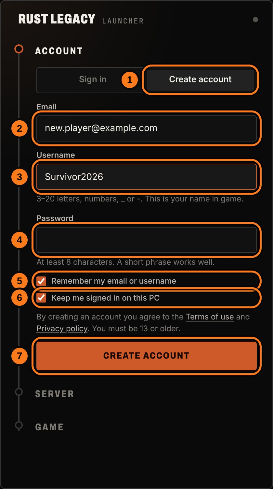
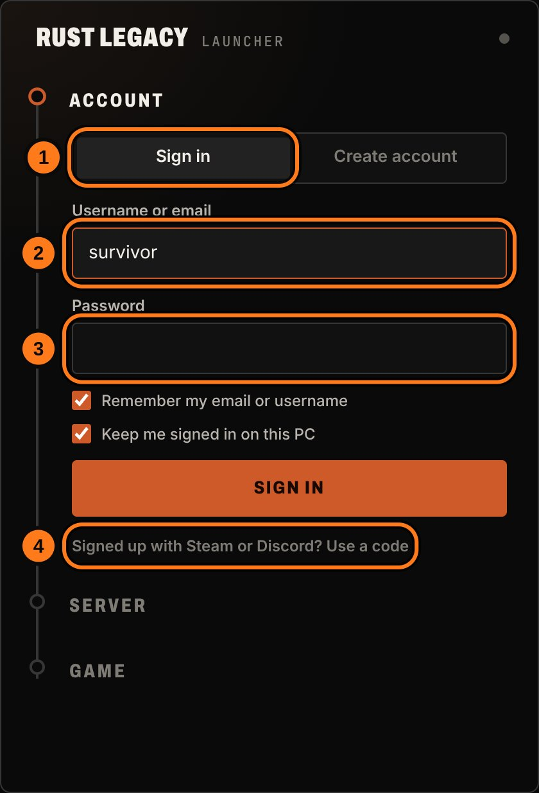
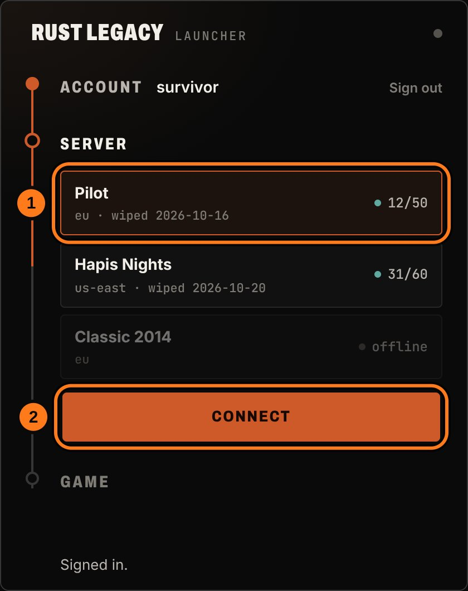
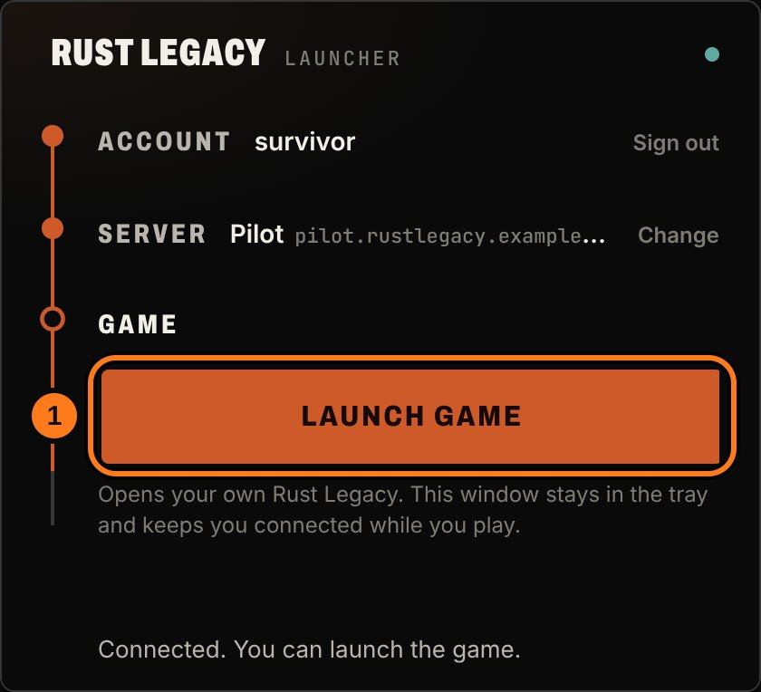
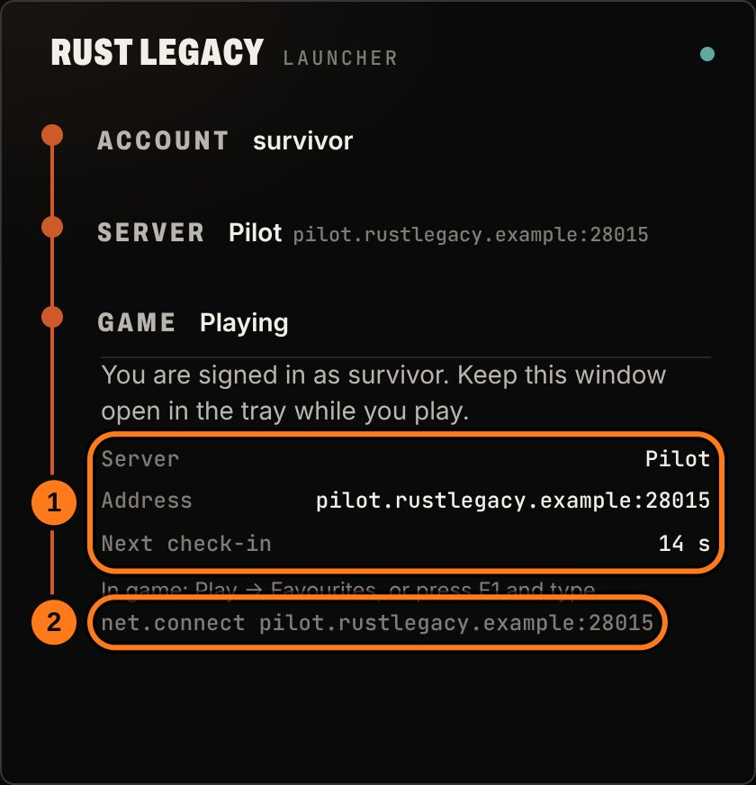

The **game loader** is a small Windows app for players who prefer the original desktop game to the browser. It signs you in with your website account, lets you pick a server and starts **your own copy** of the game. Your character is the same one you play in the browser.

The loader is being tested now. The download box above has the current version, its size and its SHA-256 once it's published; until then, ask in our [Discord](https://discord.gg/your-invite) to try it. Everything we publish is also on [Downloads](/downloads).

## What you need

- Windows, and your own installed copy of the Rust Legacy desktop game. The loader never downloads or ships the game.
- An account on this website. You can make one in the loader.

## Install

1. Download `RustLegacyLoader-<version>.zip` and [check its SHA-256](/downloads#dl-check-h) matches the one in the download box.
2. Right-click the zip, choose **Extract All**, and open the folder.
3. Double-click **Install.cmd**. Windows may warn about a file from the internet: the loader isn't code-signed yet, so choose **Run** (or **More info**, then **Run anyway**).

It installs for your Windows user only and needs no administrator rights, then adds **Rust Legacy Launcher** to the Start menu. If your PC is missing Microsoft's WebView2 or .NET 8 Desktop Runtime, it says so and links to Microsoft's download. You can delete the zip and the extracted folder afterwards.

## 1. Account

**Sign in** with your username or email and password, or press **Create account** to make one:

1. **Create account**: switches the form from signing in to making a new account.
2. **Email**: used to sign in and to reset your password.
3. **Username**: your name in game. 3–20 letters, numbers, `_` or `-`.
4. **Password**: at least 8 characters.
5. **Remember my email or username**: fills it in next time.
6. **Keep me signed in on this PC**: no password next time. Untick it on a shared computer.
7. **Create account**: makes the account and signs you in.

You can play straight away, and the same details sign you in on this website.

Your password is never saved on your PC. "Keep me signed in" saves a sign-in token instead, locked to your Windows account. You can sign it out from your [account page](/account) at any time.

1. **Sign in**: the form for an existing account.
2. Your **email or username**.
3. Your **password**.
4. **Use a code**: for accounts made with Steam or Discord (below).

**Signed up with Steam or Discord?** You have no password, so press **Use a code**. The loader shows a short code; press **Open the website** (or go to [Sign in a launcher](/desktop/approve) yourself) while signed in, and type the code there.

## 2. Server

1. **Pick a server.** Each shows its region, last wipe and players online.
2. **Connect**: checks you can join.

Pick a server from the list and press **Connect**. Servers that are offline are greyed out. The loader checks you can join (not banned, and you meet the server's rules) and tells you plainly if not.

Only servers that run our server software accept the loader. On those servers, your character belongs to your website account, so you keep it from any PC and from the browser.

## 3. Game

1. **Launch game**: starts your own copy of the game.

The first time, choose the folder your game is installed in (the one with `rust.exe`). Then press **Launch game**. Your server is at the top of **Favourites** in the game's server list.

1. Where you're playing, and when the loader next checks in with the website.
2. How to join the server in game, if it isn't already in your **Favourites**.

While you play, the loader waits in the system tray and keeps your session alive. Closing its window while in game just hides it to the tray.

**Keep the loader running while you play.** If you quit it, or your PC loses its connection, the server ends your session about a minute later, so nobody else can use it.

## Signing out

Choose **Sign out** in the loader, or sign out each launcher from your [account page](/account). **Sign out everywhere** on the account page signs out every launcher too.

## Uninstall

Use **Settings → Apps** in Windows, or run the uninstaller from the install folder. It removes the loader and its launch folder. Your game folder is never touched.

## If something goes wrong

| Message | What to do |
| --- | --- |
| *That username is taken. Try another.* | Pick another username. |
| *An account already uses that email. Sign in instead.* | Sign in, or reset your password on the website. |
| *This server needs an older account* (or another rule) | The server has rules for joining. Its page on the website lists them. |
| *You are banned from this server.* | Ask the server's owner on their Discord. |
| The game can't find the server | Choose it from **Favourites** in the game's server list, or open the F1 console and type `net.connect` followed by the address the loader shows. |
